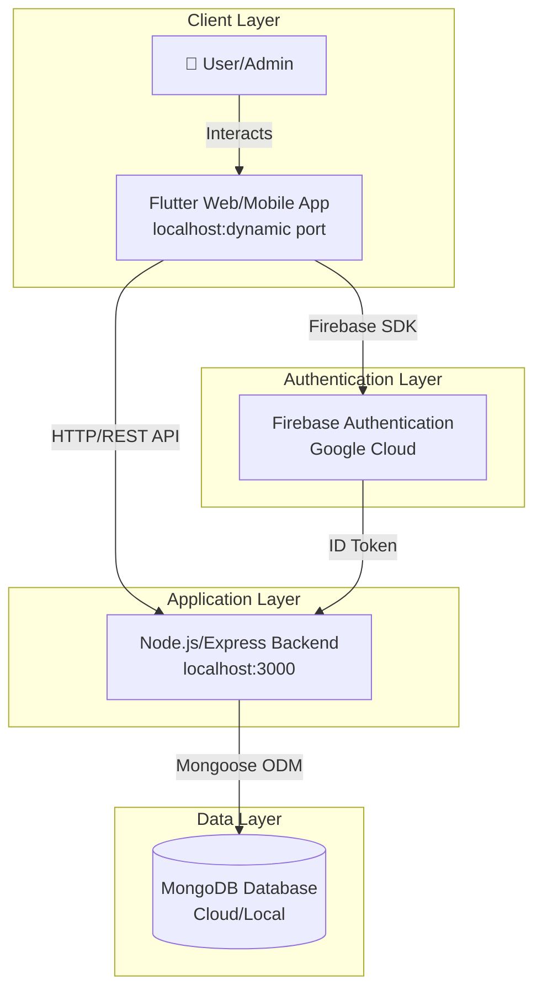
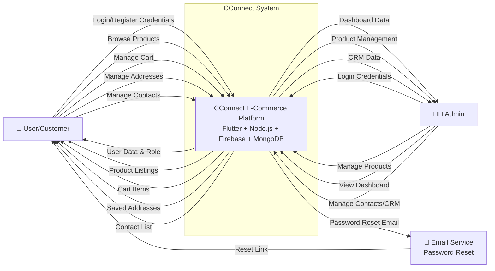
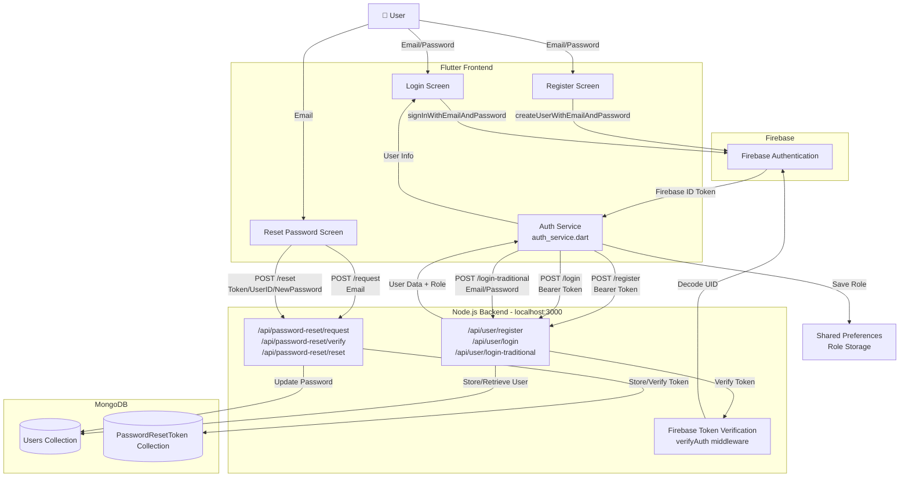
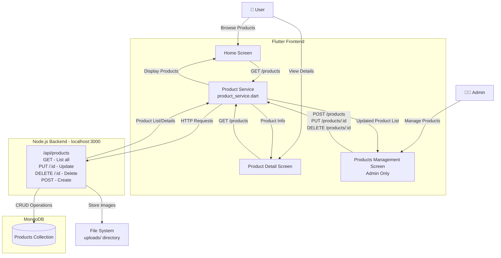
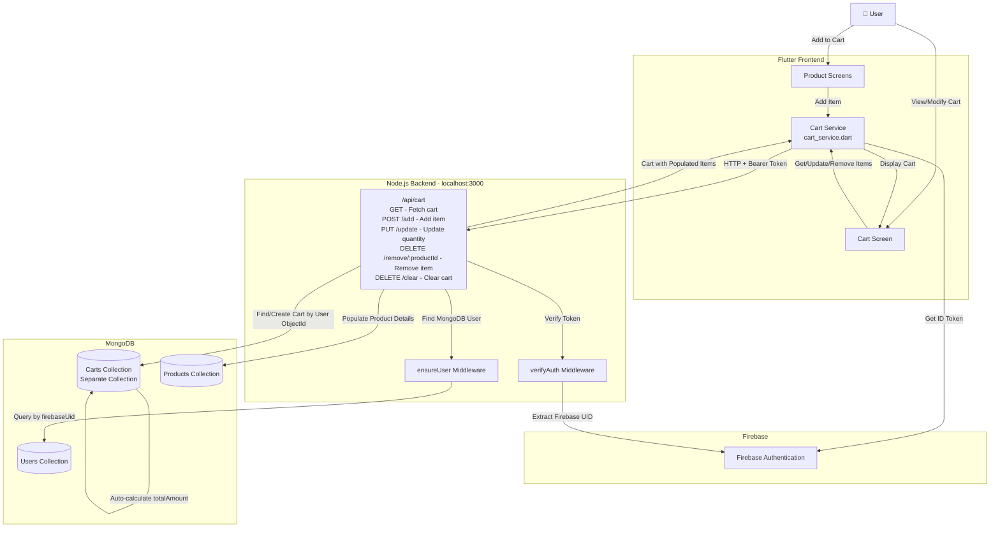
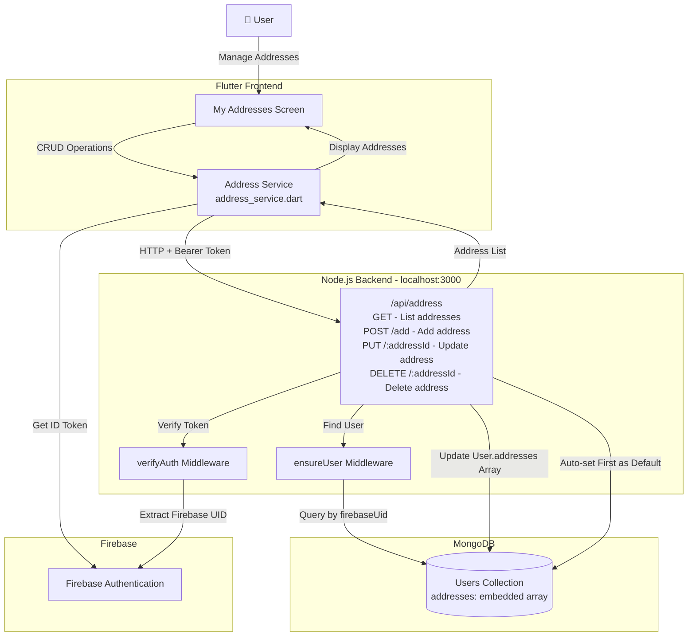

# Physical Data Flow Diagram (DFD) - CConnect Application

## Overview
This document presents the Physical Data Flow Diagram for the CConnect e-commerce application, showing the actual implementation of data flows between physical components including the Flutter frontend, Node.js backend, Firebase authentication, and MongoDB database.

---

## System Architecture Diagram



---

## Detailed Physical DFD - Level 0 (Context Diagram)



---

## Physical DFD - Level 1 (Authentication & User Management)



---

## Physical DFD - Level 1 (Product Management)



---

## Physical DFD - Level 1 (Cart Management)



---

## Physical DFD - Level 1 (Address Management)



---

## Physical DFD - Level 1 (Contacts/CRM Management)

```mermaid
graph TB
    User[👤 User/Admin]
    
    subgraph "Flutter Frontend"
        ContactsScreen[Contacts Screen]
        ContactService[Contact Service<br/>contact_service.dart]
    end
    
    subgraph "Firebase"
        FirebaseAuth[Firebase Authentication]
    end
    
    subgraph "Node.js Backend - localhost:3000"
        ContactAPI["/api/contacts<br/>GET - List all<br/>GET /:id - Get one<br/>POST - Create<br/>PUT /:id - Update<br/>DELETE /:id - Soft delete"]
        AuthMiddleware[verifyFirebaseToken Middleware]
    end
    
    subgraph "MongoDB"
        ContactDB[(Contacts Collection<br/>owner: firebaseUid<br/>deleted: boolean)]
    end
    
    User -->|Manage Contacts| ContactsScreen
    
    ContactsScreen -->|CRUD Operations| ContactService
    ContactService -->|Get ID Token| FirebaseAuth
    ContactService -->|HTTP + Bearer Token| ContactAPI
    
    ContactAPI -->|Verify Token| AuthMiddleware
    AuthMiddleware -->|Extract Firebase UID| FirebaseAuth
    
    ContactAPI -->|Filter by owner (firebaseUid)| ContactDB
    ContactAPI -->|Soft Delete (set deleted=true)| ContactDB
    ContactAPI -->|Contact List/Details| ContactService
    
    ContactService -->|Display Contacts| ContactsScreen
```

---

## Data Flow Details

### Authentication Flow

#### Firebase Registration Flow
1. User enters email/password in `RegisterScreen`
2. Flutter calls `FirebaseAuth.createUserWithEmailAndPassword()`
3. Firebase creates user account and returns `UserCredential`
4. Flutter extracts Firebase ID Token
5. `AuthService.registerWithEmail()` sends POST to `/api/user/register` with Bearer token
6. Backend `verifyAuth` middleware verifies token with Firebase Admin SDK
7. Backend creates user record in MongoDB with role ('admin' for adminacc@gmail.com, 'user' otherwise)
8. Backend returns user data with role
9. Flutter saves role to SharedPreferences
10. User is redirected based on role

#### Firebase Login Flow
1. User enters credentials in `LoginScreen`
2. Flutter calls `FirebaseAuth.signInWithEmailAndPassword()`
3. Firebase authenticates and returns `UserCredential`
4. Flutter extracts Firebase ID Token
5. `AuthService.loginWithEmail()` sends POST to `/api/user/login` with Bearer token
6. Backend verifies token and retrieves user from MongoDB
7. Backend returns user data with role
8. If Firebase login fails, fallback to traditional login
9. Flutter saves role and redirects user

#### Traditional Login Flow (Password Reset Users)
1. User enters credentials in `LoginScreen`
2. `AuthService.loginWithTraditional()` sends POST to `/api/user/login-traditional`
3. Backend validates email/password against MongoDB (bcrypt)
4. Backend returns user data with role
5. Flutter saves role and redirects user

#### Password Reset Flow
1. User enters email in `ForgotPasswordScreen`
2. `AuthService.requestPasswordReset()` sends POST to `/api/password-reset/request`
3. Backend generates reset token and stores in `PasswordResetToken` collection
4. Backend sends email with reset link containing token and userId
5. User clicks link and opens `ResetPasswordScreen`
6. User enters new password
7. `AuthService.resetPassword()` sends POST to `/api/password-reset/reset`
8. Backend verifies token and updates password in MongoDB User collection
9. User can now login with traditional method

---

### Product Management Flow

#### Fetch Products
1. User opens `HomeScreen` or `ProductDetailScreen`
2. `ProductService.getProducts()` sends GET to `/api/products`
3. Backend queries MongoDB Products collection
4. Backend returns product array
5. Flutter displays products in UI

#### Admin Product CRUD
1. Admin opens `ProductsManagementScreen`
2. Admin creates/updates/deletes product
3. `ProductService` sends POST/PUT/DELETE to `/api/products/:id`
4. Backend performs operation on MongoDB
5. For image uploads, backend stores files in `uploads/` directory
6. Backend returns updated product or success status
7. Flutter refreshes product list

---

### Cart Management Flow

#### Add Item to Cart
1. User adds product to cart from product screen
2. `CartService.addItem()` gets Firebase ID token
3. Sends POST to `/api/cart/add` with Bearer token and `{productId, quantity}`
4. Backend `verifyAuth` middleware verifies token and extracts Firebase UID
5. Backend `ensureUser` middleware finds MongoDB User by `firebaseUid`
6. Backend finds or creates Cart document for user (by User ObjectId)
7. Backend validates product exists in Products collection
8. If item exists in cart, increment quantity; otherwise add new item
9. Cart model's `pre('save')` hook auto-calculates `totalAmount`
10. Backend populates product details and returns cart
11. Flutter updates cart UI

#### Get/Update/Remove/Clear Cart
- Similar flow with different endpoints and operations
- All operations use `verifyAuth` → `ensureUser` → Cart CRUD
- Cart items are populated with full product details on retrieval

---

### Address Management Flow

#### Add Address
1. User opens `MyAddressesScreen` and adds new address
2. `AddressService.addAddress()` gets Firebase ID token
3. Sends POST to `/api/address/add` with Bearer token and address data
4. Backend `verifyAuth` verifies token, `ensureUser` finds user
5. Backend validates required fields (street, city, state, zipCode, country)
6. If `isDefault=true`, backend unsets other addresses' default flags
7. If first address, automatically set as default
8. Backend pushes new address to User's `addresses` embedded array
9. Backend saves user and returns updated addresses array
10. Flutter displays updated address list

#### Update/Delete Address
- Similar flow using address `_id` from embedded array
- Update uses Mongoose subdocument methods (`addresses.id()`)
- Delete uses `pull()` to remove from array

---

### Contacts/CRM Management Flow

#### List Contacts
1. User/Admin opens contacts screen
2. `ContactService.getContacts()` gets Firebase ID token
3. Sends GET to `/api/contacts` with Bearer token
4. Backend `verifyFirebaseToken` middleware extracts Firebase UID
5. Backend queries Contacts collection filtering by `owner: firebaseUid` and `deleted: false`
6. Backend returns contact list
7. Flutter displays contacts

#### Create/Update/Delete Contact
- All operations require authentication
- Contacts are filtered by owner (Firebase UID)
- Delete is soft-delete (sets `deleted: true`)
- Each user can only access their own contacts

---

## Technology Stack

### Frontend (Flutter)
- **Platform**: Web (localhost:dynamic), Android (10.0.2.2:3000), iOS
- **State Management**: StatefulWidget
- **HTTP Client**: `http` package
- **Local Storage**: `shared_preferences` (role storage)
- **Authentication**: `firebase_auth` package

### Backend (Node.js)
- **Server**: Express.js on localhost:3000 (0.0.0.0:3000)
- **Authentication**: Firebase Admin SDK
- **Database ODM**: Mongoose
- **Password Hashing**: bcrypt
- **CORS**: Dynamic localhost origin support
- **Email**: Nodemailer (password reset)
- **File Upload**: Express static serving (`/uploads`)

### Database (MongoDB)
- **Collections**:
  - `users` - User accounts with embedded addresses array and role
  - `carts` - Separate cart collection with user reference and items array
  - `products` - Product catalog
  - `contacts` - CRM contacts with soft delete
  - `passwordresettokens` - Password reset tokens
  - ~~`orders`~~ - Not yet implemented

### External Services
- **Firebase Authentication**: Google Cloud
- **Email Service**: SMTP (Nodemailer) for password reset

---

## Network Communication

### API Endpoints

#### Authentication
- `POST /api/user/register` - Firebase-based registration
- `POST /api/user/login` - Firebase-based login
- `POST /api/user/login-traditional` - MongoDB-based login
- `POST /api/password-reset/request` - Request reset link
- `GET /api/password-reset/verify` - Verify reset token
- `POST /api/password-reset/reset` - Reset password

#### Products
- `GET /api/products` - List all products
- `POST /api/products` - Create product (admin)
- `PUT /api/products/:id` - Update product (admin)
- `DELETE /api/products/:id` - Delete product (admin)

#### Cart (Authenticated)
- `GET /api/cart` - Fetch user's cart
- `POST /api/cart/add` - Add item to cart
- `PUT /api/cart/update` - Update item quantity
- `DELETE /api/cart/remove/:productId` - Remove item
- `DELETE /api/cart/clear` - Clear entire cart

#### Addresses (Authenticated)
- `GET /api/address` - List user's addresses
- `POST /api/address/add` - Add new address
- `PUT /api/address/:addressId` - Update address
- `DELETE /api/address/:addressId` - Delete address

#### Contacts/CRM (Authenticated)
- `GET /api/contacts` - List user's contacts
- `GET /api/contacts/:id` - Get single contact
- `POST /api/contacts` - Create contact
- `PUT /api/contacts/:id` - Update contact
- `DELETE /api/contacts/:id` - Soft delete contact

### Authentication Headers
```
Authorization: Bearer <Firebase_ID_Token>
Content-Type: application/json
```

### Middleware Chain
```
Request → verifyAuth/verifyFirebaseToken → ensureUser (if needed) → Route Handler
```

---

## Data Stores

### SharedPreferences (Flutter Local Storage)
```
Key: 'user_role'
Value: 'admin' | 'user'
```

### MongoDB Collections Schema

#### Users Collection
```json
{
  "_id": "ObjectId",
  "firebaseUid": "string (unique)",
  "email": "string (unique)",
  "password": "string (hashed, select: false)",
  "role": "admin | user",
  "isVerified": "boolean",
  "resetPasswordToken": "string",
  "resetPasswordExpires": "Date",
  "addresses": [
    {
      "_id": "ObjectId (auto-generated)",
      "street": "string",
      "city": "string",
      "state": "string",
      "zipCode": "string",
      "country": "string",
      "isDefault": "boolean"
    }
  ]
}
```

#### Carts Collection (Separate Collection)
```json
{
  "_id": "ObjectId",
  "user": "ObjectId (ref: User, unique)",
  "items": [
    {
      "product": "ObjectId (ref: Product)",
      "quantity": "number (min: 1)",
      "price": "number"
    }
  ],
  "totalAmount": "number (auto-calculated)",
  "updatedAt": "Date"
}
```

#### Products Collection
```json
{
  "_id": "ObjectId",
  "name": "string",
  "description": "string",
  "price": "number",
  "imageUrl": "string",
  "stock": "number",
  "category": "string"
}
```

#### Contacts Collection
```json
{
  "_id": "ObjectId",
  "name": "string (required)",
  "email": "string",
  "phone": "string",
  "owner": "string (firebaseUid, required)",
  "deleted": "boolean (default: false)",
  "createdAt": "Date",
  "updatedAt": "Date"
}
```

#### PasswordResetTokens Collection
```json
{
  "_id": "ObjectId",
  "userId": "string",
  "token": "string",
  "expiresAt": "Date",
  "used": "boolean"
}
```

---

## Security Considerations

1. **Firebase ID Token Verification**: All authenticated endpoints verify Firebase tokens server-side via `verifyAuth` or `verifyFirebaseToken` middleware
2. **Role-Based Access Control**: Admin endpoints check user role from MongoDB
3. **Password Hashing**: bcrypt for traditional login passwords (select: false prevents exposure)
4. **Token Expiration**: Reset tokens expire after set duration
5. **CORS Configuration**: Backend allows dynamic localhost origins for development, restricted in production via `CLIENT_ORIGIN` env variable
6. **Data Isolation**: 
   - Contacts filtered by `owner` (firebaseUid)
   - Carts linked to specific users
   - Addresses embedded in user documents
7. **Soft Delete**: Contacts use soft delete to preserve data integrity
8. **Middleware Chain**: Two-step verification (Firebase token → MongoDB user lookup)

---

## Deployment Architecture

### Development
- **Frontend**: `localhost:<dynamic_port>` (Flutter web dev server)
- **Backend**: `localhost:3000` (Node.js Express on 0.0.0.0:3000)
- **Database**: MongoDB local or cloud (MongoDB Atlas)
- **Firebase**: Google Cloud
- **File Storage**: Local `uploads/` directory

### Production (Recommended)
- **Frontend**: Deployed to Firebase Hosting / Vercel / Netlify
- **Backend**: Deployed to Render / Heroku / AWS / Railway
- **Database**: MongoDB Atlas (cloud)
- **Firebase**: Google Cloud (production project)
- **File Storage**: AWS S3 / Cloudinary / Firebase Storage
- **Environment Variables**: 
  - `MONGODB_URI`
  - `CLIENT_ORIGIN`
  - `API_BASE_URL`
  - Firebase service account credentials
  - SMTP credentials

---

## Key Implementation Details

### Cart Architecture
- **Separate Collection**: Unlike typical embedded arrays, carts are stored as separate documents
- **User Reference**: Cart references User by ObjectId (not firebaseUid)
- **Auto-calculation**: `totalAmount` is automatically calculated via Mongoose `pre('save')` hook
- **Population**: Product details are populated on retrieval for rich cart data

### Address Architecture
- **Embedded Array**: Addresses are stored as subdocuments in User collection
- **Auto-default**: First address is automatically set as default
- **Mongoose Subdocuments**: Uses Mongoose subdocument methods (`id()`, `pull()`)

### Authentication Architecture
- **Dual System**: Firebase for new users, traditional for password-reset users
- **Two-step Middleware**: 
  1. `verifyAuth` extracts Firebase UID from token
  2. `ensureUser` finds MongoDB user by firebaseUid
- **Admin Detection**: Hardcoded email check (`adminacc@gmail.com`)

### Contacts/CRM Architecture
- **User Isolation**: Each user can only access their own contacts via `owner` field
- **Soft Delete**: Preserves data with `deleted` flag instead of hard deletion
- **Timestamps**: Automatic `createdAt` and `updatedAt` tracking

---

## Notes

- The system uses dual authentication: Firebase for new users, MongoDB for password-reset users
- Admin role is determined by email (`adminacc@gmail.com`)
- Cart data is stored in **separate Cart collection** (not embedded in User)
- Address data is stored as **embedded array in User collection**
- All authenticated requests require Firebase ID token in Authorization header
- Platform-specific backend URLs (web: localhost, Android: 10.0.2.2)
- CORS allows any localhost origin in development for Flutter's dynamic ports
- Contacts module provides basic CRM functionality with soft delete
- Orders module is planned but not yet implemented
